### Create a Docker file for the web application container which should include the necessary dependencies to run the web application. The web application should display a simple  "Hello, World!" message when accessed from a web browser.


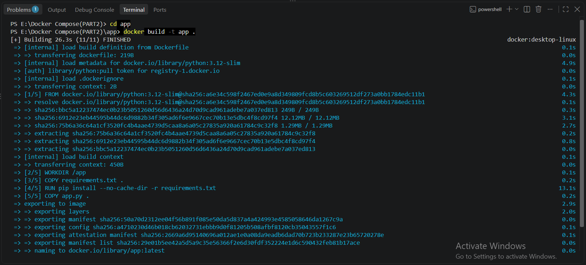
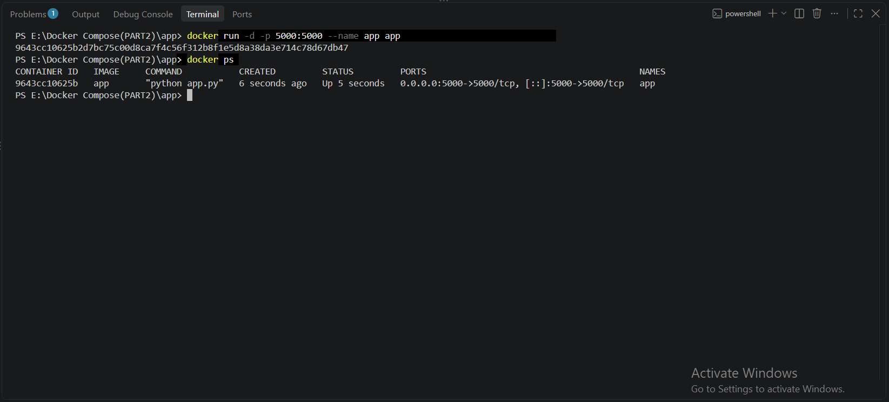

**DOCKERFILE**
```bash

FROM python:3.12-slim

WORKDIR /app

COPY requirements.txt .
RUN pip install --no-cache-dir -r requirements.txt

COPY app.py .

EXPOSE 5000

CMD ["python", "app.py"]

```
**Description:** Created a Dockerfile using Python 3.12, installed the required dependencies, and built and ran the web application in a Docker container. The application is accessible at http://localhost:5000 and displays “Hello, World!” in the web browser.

**verification**
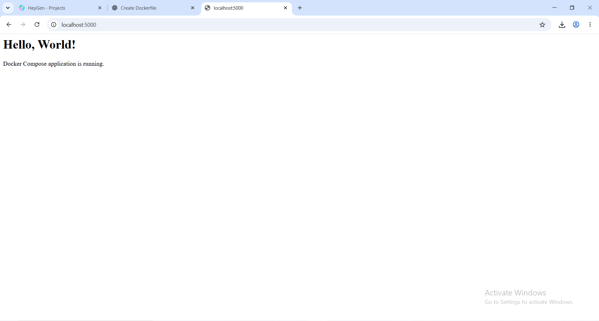


### Create a Docker file for the database container which should include the necessary dependencies to run the database. You can use any database of your choice (e.g.,MySQL, PostgreSQL, MongoDB, etc.).

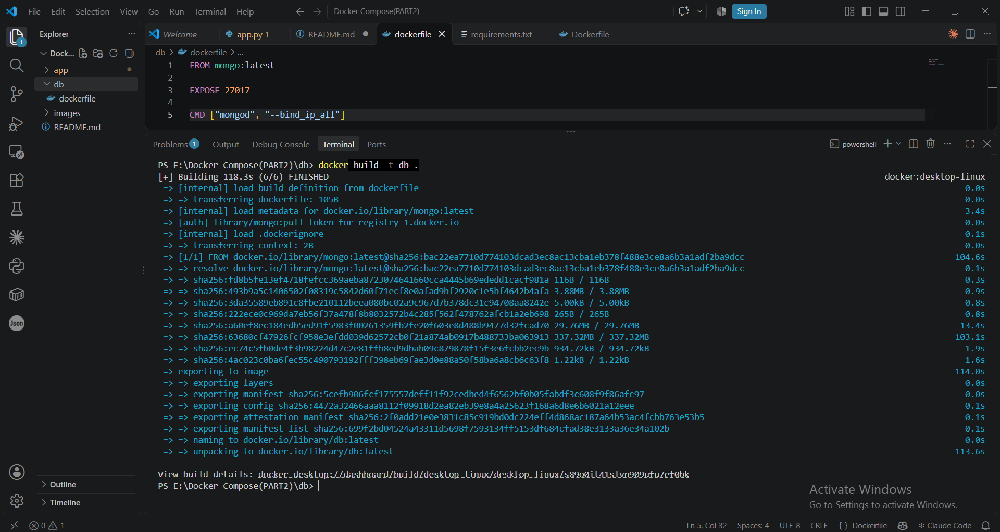
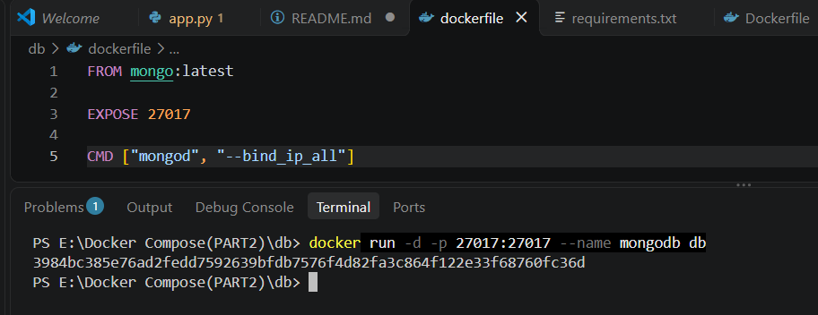

```bash
FROM mongo:latest

EXPOSE 27017

CMD ["mongod", "--bind_ip_all"]

```
**Description:** This workflow uses a Dockerfile based on mongo:latest to build a custom Docker image named db configured to accept connections on port 27017 from any IP address. It then successfully runs this image as a detached container named mongodb, mapping port 27017 from the container to your local machine.
 **Verification**

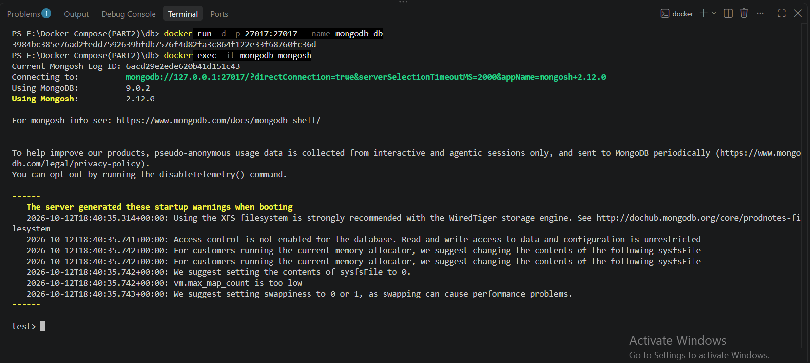
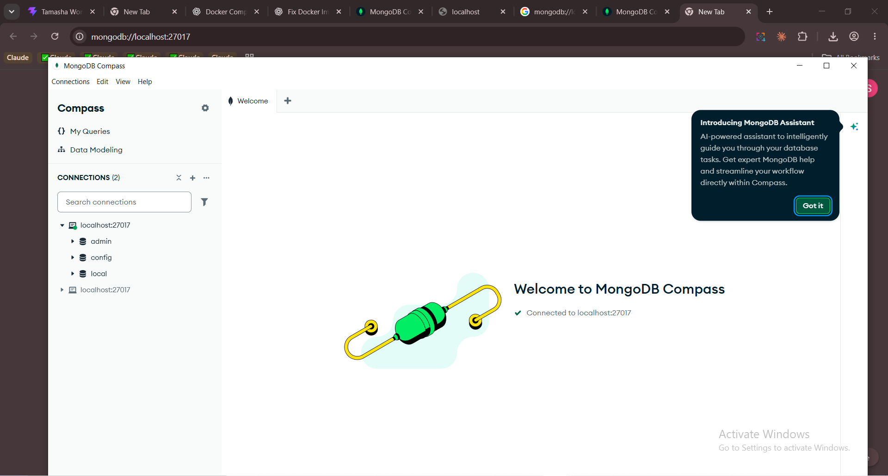

### Create a docker-compose.yml file that defines the two services - web and database. The web service should be linked to the database service using Docker Compose networking. 

```bash

services:
  web:
    build:
      context: ../task3
      dockerfile: Dockerfile
    ports:
      - "5000:5000"
    environment:
      MONGO_URI: "mongodb://mongodb:27017/"
    depends_on:
      - mongodb

  mongodb:
    image: mongo:latest
    ports:
      - "27017:27017"
    volumes:
      - mongo_data:/data/db

volumes:
  mongo_data:
```


### Use the docker-compose up command to build and run the application. Verify that the  web application is accessible from a web browser and that the database is running. 


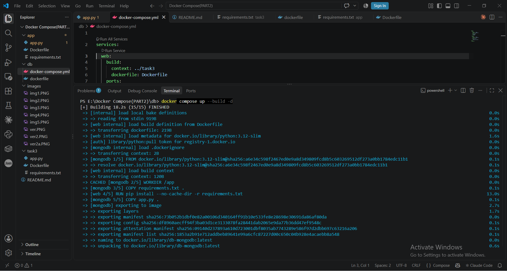


 **Verification**

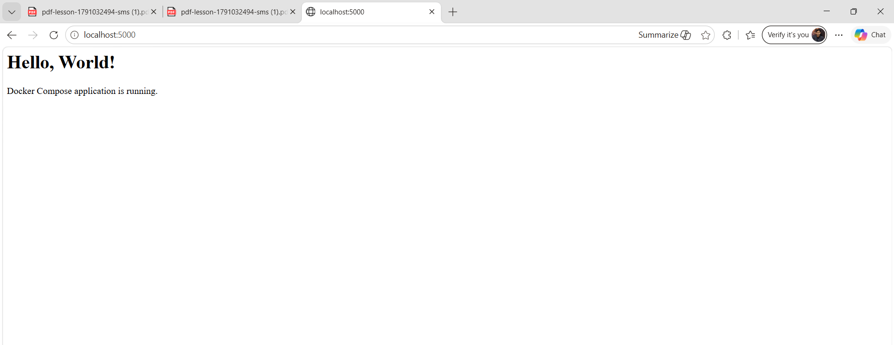
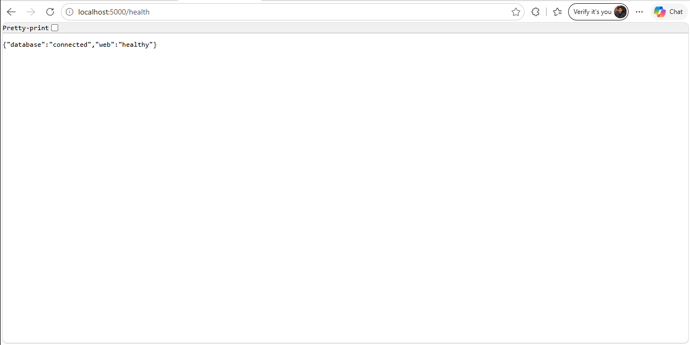


### Modify the Docker file for the web application container to include a new feature (e.g.,  a new message, a new page, etc.). Rebuild the web application container and  redeploy the application using docker-compose. Verify that the new feature is working  as expected. 


```bash

@app.route("/newone")
def newFearyre():
    return """
    <html>
        <head>
            <title>Updated Docker Web App</title>
        </head>
        <body style="text-align:center; font-family:Arial;">
            <h1>Hello, World!</h1>
            <h2>New Feature Added Successfully!</h2>
            <p>This web application has been updated using Docker Compose.</p>
        </body>
    </html>
    """

```


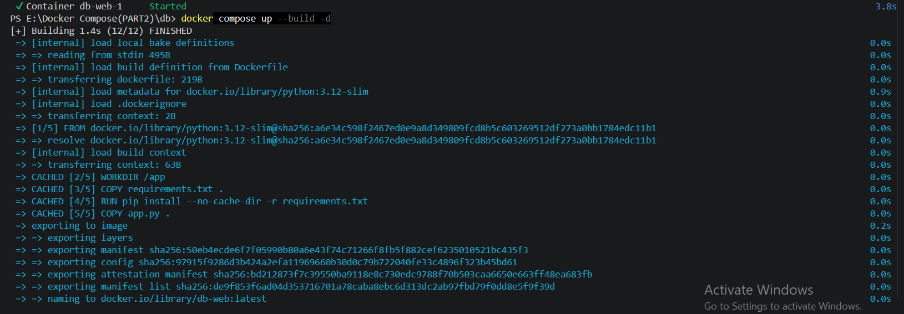


 **Verification**

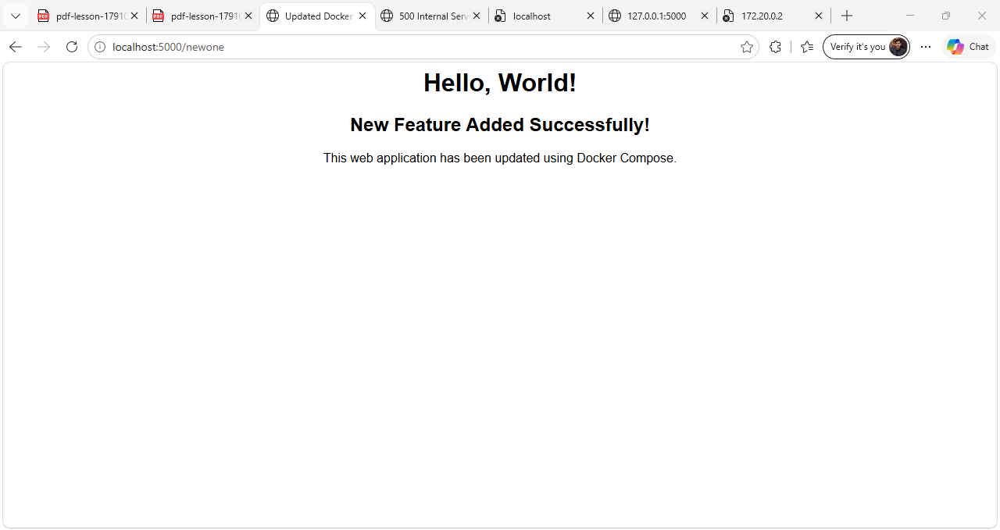

### 


### Implement a scaling strategy for the web application. This can be achieved by using the  docker-compose scale command to create multiple instances of the web service. Verify  that the web application is accessible and working correctly when scaled.
```bash


services:
  web:
    build:
      context: ../task3
      dockerfile: Dockerfile
    expose:
      - "5000"
    environment:
      MONGO_URI: "mongodb://mongodb:27017/"
    depends_on:
      - mongodb

  mongodb:
    image: mongo:latest
    ports:
      - "27017:27017"
    volumes:
      - mongo_data:/data/db

  nginx:
    image: nginx:alpine
    ports:
      - "8080:80"
    volumes:
      - ./nginx.conf:/etc/nginx/nginx.conf:ro
    depends_on:
      - web

volumes:
  mongo_data:


```

**Description:**We configured the `docker-compose.yml` file to run three instances of the web application and added an Nginx configuration (`nginx.conf`) to distribute incoming requests across the web containers. We then rebuilt and deployed the services and verified that the application was accessible through `http://localhost:8080` .(`nginx.conf`) is shown as below and modified `docker-compose.yml` is show above  

```bash 
events {}

http {
    upstream web_servers {
        server web:5000;
    }

    server {
        listen 80;

        location / {
            proxy_pass http://web_servers;
        }
    }
}
```


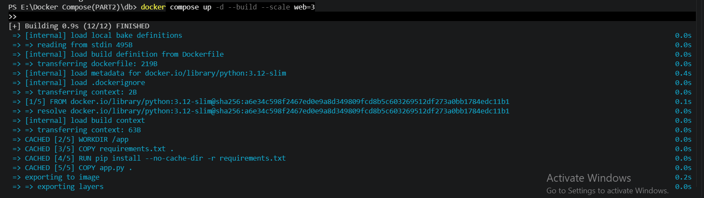


**Description:**This command uses Docker Compose to build and start your application services in the background (-d), utilizing cached and updated image layers based on your configuration files. It forces Docker to rebuild the images from scratch (--build) using Python 3.12-slim and dynamically scales the web service to run three separate container instances simultaneously (--scale web=3)

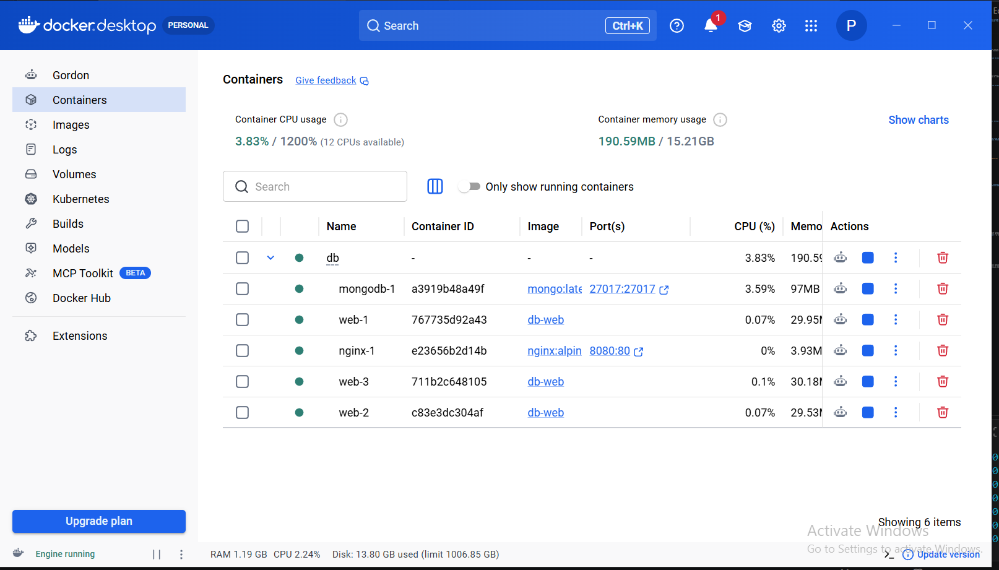

 **Verification**

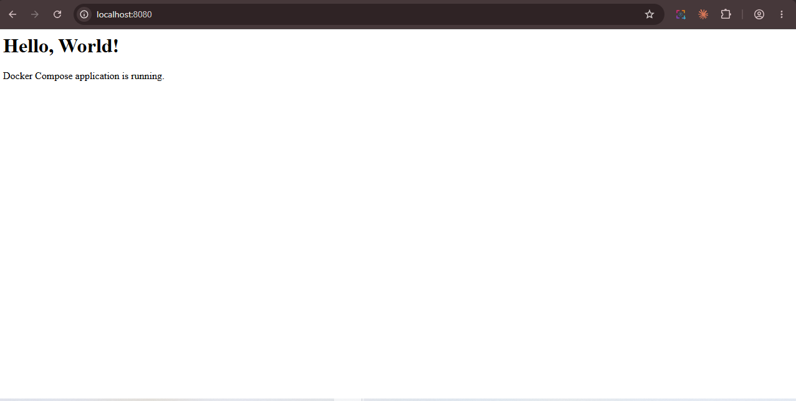

### Implement a monitoring strategy for the application. This can be achieved by using a tool like Prometheus or Grafana to monitor the health and performance of the containers.

This setup adds container monitoring to the application using **cAdvisor**, **Prometheus**, and **Grafana**. cAdvisor collects CPU, memory, and network metrics from each Docker container. Prometheus scrapes and stores those metrics, and Grafana displays them on dashboards. Together they let us check the health and performance of the web, database, and proxy containers in real time.

**Updated Docker compose**

```bash

services:
  web:
    build:
      context: ../task3
      dockerfile: Dockerfile
    expose:
      - "5000"
    environment:
      MONGO_URI: "mongodb://mongodb:27017/"
    depends_on:
      - mongodb

  mongodb:
    image: mongo:latest
    ports:
      - "27017:27017"
    volumes:
      - mongo_data:/data/db

  nginx:
    image: nginx:alpine
    ports:
      - "8080:80"
    volumes:
      - ./nginx.conf:/etc/nginx/nginx.conf:ro
    depends_on:
      - web

  cadvisor:
    image: gcr.io/cadvisor/cadvisor:latest
    ports:
      - "8081:8080"
    volumes:
      - /:/rootfs:ro
      - /var/run:/var/run:ro
      - /sys:/sys:ro
      - /var/lib/docker:/var/lib/docker:ro
      - /dev/disk:/dev/disk:ro
    privileged: true

  prometheus:
    image: prom/prometheus:latest
    command:
      - "--config.file=/etc/prometheus/prometheus.yaml"
    ports:
      - "9090:9090"
    volumes:
      - ./prometheus:/etc/prometheus:ro
      - prometheus_data:/prometheus
    depends_on:
      - cadvisor

  grafana:
    image: grafana/grafana:latest
    ports:
      - "3000:3000"
    environment:
      GF_SECURITY_ADMIN_USER: admin
      GF_SECURITY_ADMIN_PASSWORD: admin
    volumes:
      - grafana_data:/var/lib/grafana
    depends_on:
      - prometheus

volumes:
  mongo_data:
  prometheus_data:
  grafana_data:
```


**Verification**
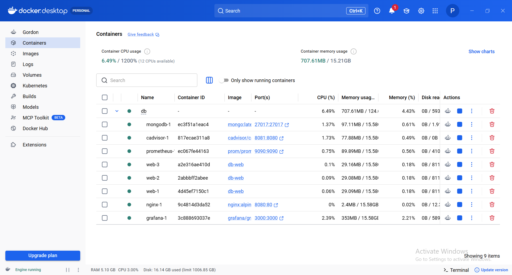

## Prometheus

Prometheus scrapes metrics every 15 seconds from itself and from cAdvisor. The `prometheus.yaml` file defines these two targets.

```yaml
global:
  scrape_interval: 15s

scrape_configs:
  - job_name: prometheus
    static_configs:
      - targets: ["localhost:9090"]

  - job_name: cadvisor
    static_configs:
      - targets: ["cadvisor:8080"]
```

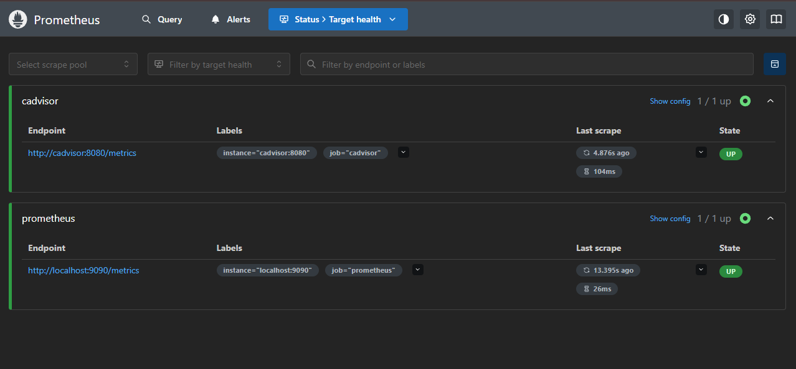

## Grafana

Grafana connects to Prometheus as a data source at `http://prometheus:9090` and uses it to build dashboards that display container CPU, memory, and health metrics.

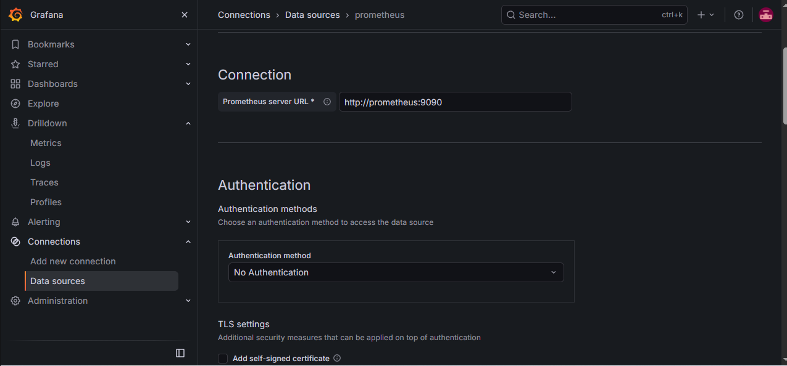

**Testing visualization**
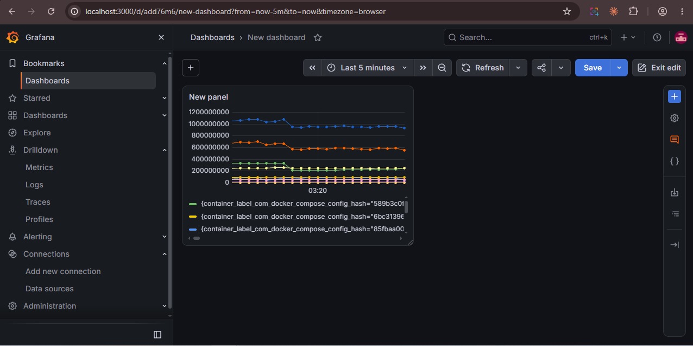